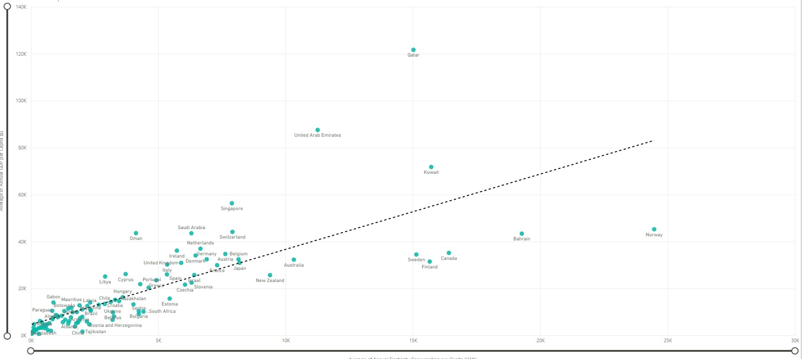
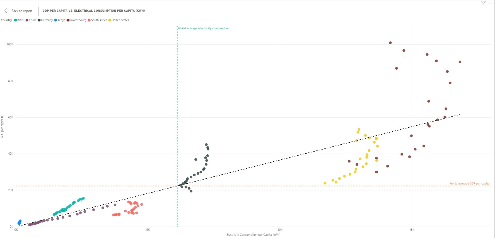
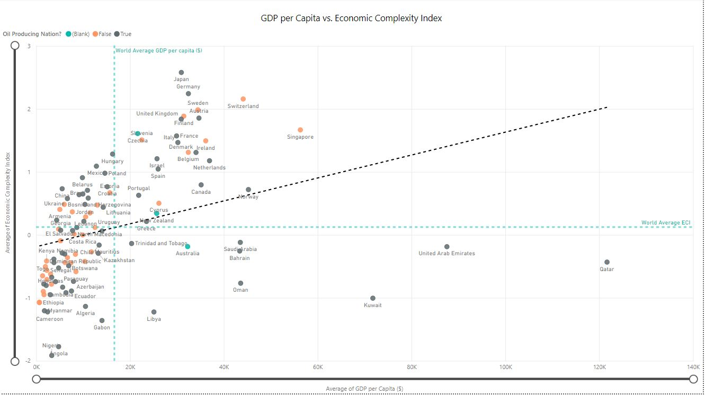
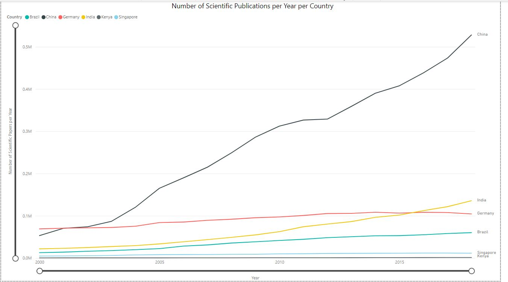
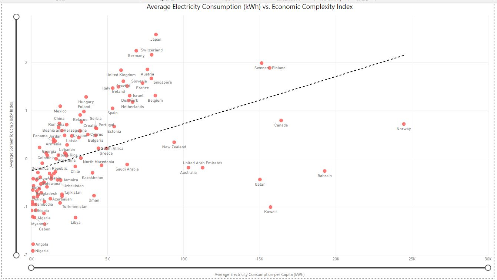
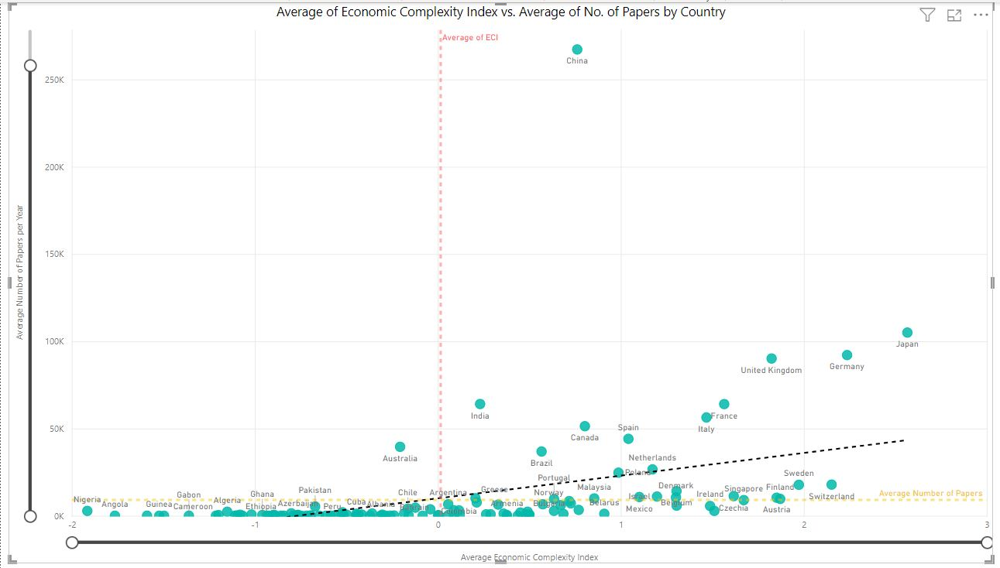

---

description: "An exploration of economic complexity, institutions, knowledge and innovation—and why some countries become richer and more capable than others."

title:  How Do Countries Develop?
date:   2024-11-06 10:53:37 +0300
categories: development economy politics
topic: "Economics & Society"
topic_slug: "economics-society"
tags: ["development", "economy", "politics"]
charts: [energy]
suite_charts: true
last_modified_at: 2026-11-09
reading_minutes: 6
permalink: /writing/how-do-countries-develop/
redirect_from:
  - /development/economy/politics/how-do-countries-develop
  - /development/economy/politics/how-do-countries-develop/
---
#### *What is the role of energy and scientific advancement in the socioeconomic development of nations?*

How do countries develop? What is development? Owen Barder[^1] argues that development is an emergent property of the socioeconomic system. He further expounds this idea by noting that development is not the sum of the well-being of people in the economy and it cannot be brought about simply by making enough people in the economy better off. Development, he argues, is instead a system-wide manifestation of the way people, firms, technologies and institutions interact with each other within the economic, social and political system. Specifically, development is the capacity of those systems to provide self-organising complexity.  Self-organising complexity in an adaptive system cannot be deliberately designed; it arises from a process of continuous adaptation and evolution.

This is a complex topic, so I focus on electricity, scientific output, and the complexity of the goods an economy exports. Electricity enables machines and infrastructure to multiply what people can produce. Its consumption is also shaped by industrial structure, climate, and income. Consumption alone does not tell us whether power is cheap, reliable, or available to everyone.

Scientific knowledge is another part of productive capability. Education, research, firms, and institutions interact in turning knowledge into useful products and services. Publication counts offer one imperfect window into that system; they do not directly measure research quality or commercial innovation.

The comparisons below explore these relationships across countries and over time. They are descriptive evidence. They cannot, on their own, isolate the causes of development or establish a universal sequence every country must follow.

### Data and definitions

The interactive figures are an updated analysis, assembled on 9 November 2026. They use:

1. **World Bank data:** electricity consumption per person, GDP per capita in purchasing-power-adjusted constant 2021 international dollars, population, and scientific publication counts[^2].
2. **Harvard Growth Lab:** the goods-based Economic Complexity Index (ECI), using the HS92 trade classification[^4]. ECI describes patterns in goods exports; it is not a complete account of domestic production or services.
3. **NSF scientific output via the World Bank:** fractional publication counts. Credit for internationally coauthored work is apportioned across countries. The figures offer both total fractional counts and counts per million people, using same-year population[^science].

Each chart shows its observation year, data edition, coverage, and source definitions. Missing values remain missing, and paths break at missing years. The original 2024 screenshots are preserved below; their underlying raw dataset is unavailable, so the new figures should not be read as exact reconstructions.

### Results and discussion

#### 1. Electricity consumption and income

The interactive figure below is an updated analysis using same-year observations, rather than the multi-year averages in the original figure. Income is now explicitly measured in purchasing-power-adjusted, constant 2021 international dollars. The source data were retrieved on 9 November 2026; the opening year is 2024 because 2025 coverage is still incomplete.



Economies with higher electricity consumption per person tend to have higher income per person. This association alone does not establish causation: electricity can enable production, while rising production also increases electricity demand. The chart measures consumption and income; it does not directly measure worker productivity, power reliability, or electricity prices.

#### 2. Different paths through time



A single-year comparison hides the route each economy took. Here, the paths connect observations for the same country over the selected period. Open circles mark first available observations; solid dots mark the selected end year. A missing endpoint is reported explicitly.

Use these paths to investigate changes in income and electricity use together. A flatter or reversing path may reflect efficiency, changes in industrial structure, economic conditions, or other influences. This chart alone cannot tell us how much each explanation contributes.

#### 3. Economic complexity and income



ECI asks what a country's goods-export pattern suggests about its productive capabilities. Compare economies with similar incomes, inspect outliers, and change the year. High income can arise through different economic structures, so the relationship need not hold uniformly.

A country's position does not establish that changing its ECI score will mechanically change its income. Building capabilities involves firms, workers, infrastructure, knowledge, and institutions; the score is a lens on part of that system.

#### 4. Scientific output and population



Total publication counts reflect the scale of a country's research system as well as its population. Switching to output per million people changes the comparison. Both views are useful, and neither measures the quality or practical value of the research.

The series ends in 2023 because that is the latest observation year available in this publication dataset. A fresh download date does not mean every indicator contains current-year observations.

#### 5. Electricity and productive capabilities



Energy and productive capabilities develop together, but economies also differ in geography, sector mix, and energy intensity. Inspect countries that use similar amounts of electricity but have different goods-export complexity scores.

ECI remains on a linear axis, including its negative values. Negative ECI is a position on the index's scale; it does not mean a country has negative production or no productive knowledge.

#### 6. Research and economic complexity



This comparison brings research output and goods-export complexity into the same view. Switching between total publications and publications per million people helps reveal the role of country size.

An association would be consistent with several explanations: research may support productive capabilities, more capable economies may fund more research, and institutions or investment may influence both. Establishing the direction and strength of these effects requires evidence beyond these comparisons.

### What can we conclude?

Development involves learning to produce increasingly valuable goods and services. These figures make energy, knowledge, and productive capabilities easier to investigate, but they do not reduce development to a single input or establish a guaranteed recipe.

1. **Make useful energy affordable and reliable.** Expanding productive access matters. Increasing consumption without useful output is not a development strategy, and this dataset does not directly measure power prices or reliability.
2. **Build the ability to learn and apply knowledge.** Education, research, engineering, and firms that put ideas to work deserve attention. Publication output is one indicator, not the objective itself.
3. **Improve the systems in which people and firms operate.** Infrastructure and institutions affect whether capabilities can combine, spread, and support more valuable activity. These charts do not isolate any one political or institutional model as the cause of success.
4. **Pursue efficiency while expanding opportunity.** Countries can increase useful energy use and adopt efficient equipment at the same time. The evidence here does not require them to become rich before becoming efficient, or settle the merits of a particular energy policy.

For Kenya, the useful question is how to strengthen these capabilities together, and how to test whether specific investments actually improve productivity and people's lives.

### Original 2024 figures

Open the six original figures

These screenshots preserve the original presentation. Their underlying raw dataset and some indicator definitions could not be recovered from the repository. They use a different data edition and should not be treated as the fallback data for the updated interactive analysis.

<figure>
  
  <figcaption>
   Average Electricity Consumption per Capita vs Average GDP per Capita
  </figcaption>
</figure>

<figure>
  
  <figcaption>
   Electricity consumption per capita vs GDP per Capita for selected countries
  </figcaption>
</figure>

<figure>
  
  <figcaption>
   GDP per Capita vs Economic Complexity Index
  </figcaption>
</figure>

<figure>
  
  <figcaption>
   Number of Scientific Publications per Country
  </figcaption>
</figure>

<figure>
  
  <figcaption>
   Electricity Consumption per Capita vs Economic Complexity Index
  </figcaption>
</figure>

<figure>
  
  <figcaption>
   Scientific Papers Published vs. Economic Complexity Index
  </figcaption>
</figure>

[^1]: https://www.cgdev.org/blog/what-development
[^2]: https://data.worldbank.org/
[^4]: https://atlas.hks.harvard.edu/
[^science]: https://databank.worldbank.org/metadataglossary/world-development-indicators/series/IP.JRN.ARTC.SC
